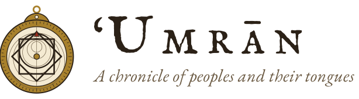
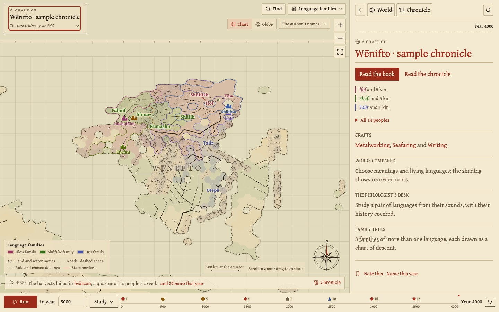
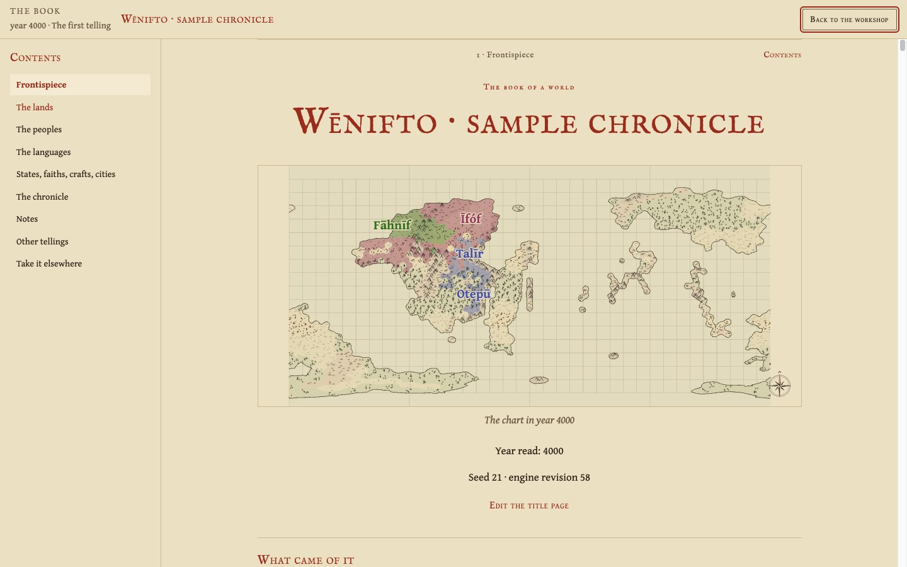

<picture>
  <source media="(prefers-color-scheme: dark)" srcset="docs/images/logo-dark.svg" />
  
</picture>

Umran simulates how languages change as peoples settle, split, trade, and
conquer. Sound laws change words regularly, neighbours borrow from one
another, and languages branch into families. Found a world, run its years,
and read its peoples, languages, and chronicle as a book.

It runs entirely in your browser, with no backend.
**[Try it](https://solforged.github.io/umran/)** or read the
[workbench guide](docs/guide.md).



## Use it

1. **Found a world.** Choose coasts, homelands, peoples, and their speech.
   To explore first, choose **Read a chronicle already written** from the
   chart room to open the sample.
2. **Run the years.** Choose a year to run to. Stop whenever you want to
   inspect a change.
3. **Read what happened.** Open places, peoples, and languages from the
   chart or Find. Follow the chronicle to sound laws, borrowed words, and
   the encounters behind them.
4. **Try another telling.** Return to an earlier year and make a decision
   to branch the history. The first future stays available for comparison.
5. **Read the book.** Open it from the world's menu. **Take it elsewhere**
   prints an edition or downloads a web page, Markdown, a save file, or
   the world frozen as data.



Worlds autosave in this browser and do not sync between devices. Download
save files as backups; clearing site data can remove saved worlds. After
one online visit, Umran can run offline and be installed as an app. See
[offline use and saving](docs/guide.md#offline-use-and-saving).

## Develop it

Install [rustup](https://rustup.rs/) and [Bun](https://bun.sh/). The Rust
version is pinned in `rust-toolchain.toml`.

```sh
bun install
bun run dev         # builds WASM and serves http://127.0.0.1:5173
bun run build       # builds the static site in dist/
bun run test:web
cargo test --workspace
```

The Rust engine lives in `crates/umran-sim`, the WebAssembly facade in
`crates/umran-web`, and the React workbench in `web/src`. All linguistic
logic runs in Rust. The [development guide](docs/development.md) covers
the architecture, checks, offline-build testing, and project layout.

## Documentation

- [Workbench guide](docs/guide.md): founding, reading, decisions, comparisons,
  exports, and offline use, with a screenshot tour.
- [Engine model](docs/engine.md): mechanisms, calibration, examples, and
  what is not yet modelled.
- [History and saving](docs/history.md): replay, branching, and save formats.
- [Product frame](docs/book.md): the book, four screens, and shared vocabulary.
- [Prose guardrails](docs/prose.md): Vale setup, audit findings, and coverage.
- [Name and mark](docs/about.md): Ibn Khaldun's *ʿumrān* and the astrolabe.

[MIT license](LICENSE)
