<picture>
  <source media="(prefers-color-scheme: dark)" srcset="docs/images/logo-dark.svg" />
  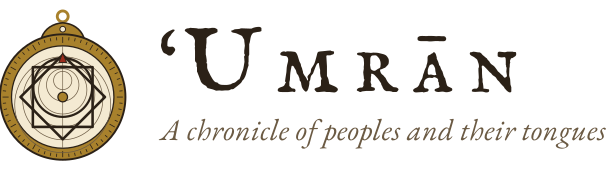
</picture>

[](https://github.com/solforged/umran/actions/workflows/ci.yml)
[](https://solforged.github.io/umran/)
[](LICENSE)

A world simulator where languages change the way real ones do. Peoples
settle a map, grow, split, trade, conquer, and give up their languages, and
every word they speak changes in response: sounds shift regularly, words
are borrowed and compete, names wear down, and families of related
languages branch out. It runs entirely in the browser.

**[Try it in your browser](https://solforged.github.io/umran/)**: the first
visit opens the chart room. Choose "Found a new world" to watch the coasts
form and found a world step by step, or "Read a chronicle already written"
to open a sample four thousand years along.

Umran writes the book of a world: its peoples, their fortunes, and the
languages that grew out of both. The simulation is how the book gets
written. You found the world, run its years, read what came of it, and
decide where a history should turn; each decision opens another telling
of the same world. Later visits resume the world left open. In the workshop
the chart fills the window and opens on its peoples, not empty seas. A
cartouche in its top-left corner names the world, its telling, and the year,
and opens the world's menu (other tellings, notes, the book, day or lamplight,
and the way back to the chart room). Find and the map's layers sit top-right;
a legend explains the ink. The chronicle's latest line is a caption over
the map's foot, and the time bar beneath runs the years to a date and draws
every turning point on a timeline, with sound changes as a quieter track
below it. The chronicle reads in eras, from the beginning, with headline
entries at full weight, a line on what happened to speech in each era, and
the year's quieter bookkeeping folded into one line; its card is a table
of contents. A people's or a language's fortunes read in the same eras.
Where the engine recorded why something happened, the chronicle says so:
"after hard times", "as the city grew", each phrase a link to the entry
that caused it. The author can also choose a sound change for a language
from the engine's catalog, previewed on the specimen.

The world is spherical; the chart remains the default view. Choose **Globe**
beside the map's navigation controls to turn the same inked world through
its poles, then return to the chart for close reading. Both views share
lands, rivers, journeys, cards, and founding placement. The engine measures
spherical areas and great-circle distances, independently of the drawing.
The default world has 2,562 regions and a radius of 1,600 km; the vast world
is Earth-sized.
New worlds use `continental-v6`, which runs a short history of plate drift:
one supercontinent rifts into plates that move apart, collide, and pass
over hotspots. The coasts, mountain ranges, island arcs, inland seas, and
lakes are what that history leaves behind, so the continents differ in
size and shape. Land covers about 30% of the sphere. Older worlds keep the
geography they were drawn with. The globe turns at frame rate on every
world size.

Hover or focus a land, river, lake, city, or marker to read its gazetteer:
what its holders call it, what other languages call it, each with its
pronunciation and meaning, and a few facts. Click to keep the place open,
then follow Open to its card.

Worlds saved before engine revision 33 keep their original data and open
recovery. Their old flat-map land IDs cannot be replayed on the new sphere.
Spherical saves retain their recorded geography when opened, exported, or
branched; a new terrain generator does not redraw an existing world.

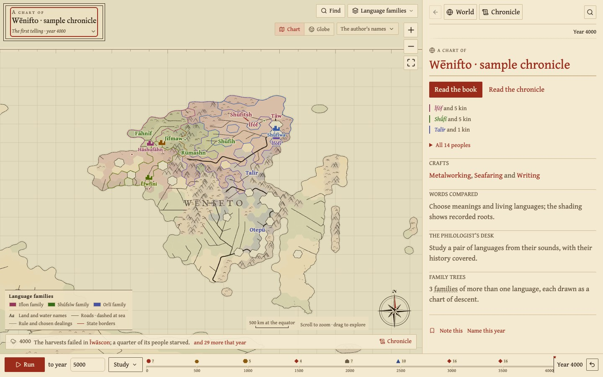

## What happens in a world

You draw a map, choose a few founding peoples, and decide how their
languages sound. Then time passes in 25-year generations, and the world
writes its own history.

- **Sound change.** Each generation a language may take up a sound law,
  such as "s becomes z between vowels". Laws apply to every word at once,
  as real sound changes do, and the odds favour changes the speakers'
  sound preferences like. Each language puts its stress somewhere, on the
  first syllable or the next to last, and stress shapes what follows:
  unstressed vowels weaken and drop, as Latin *calidus* became Italian
  *caldo*, and clusters become long consonants, as *factum* became *fatto*.
  Lost consonants can leave lexical tone. Spelling marks its six pitches
  on the vowel (á à ǎ â ả ạ), including in names and exports; IPA keeps
  Chao tone letters (˥ ˩ and contours).
- **Waves.** A sound change can spread to neighbouring languages, mostly
  between close relatives. The lines where a change stopped (isoglosses)
  cut across the family tree, as dialect maps of real languages do.
- **Words compete.** Every meaning has one or more words competing for
  use. New words arise, old ones are renewed when they wear too short or
  sound like another word, and losers fall out of use.
- **Grammar.** Founding sets word order, object marking, and possessor
  placement; daughters inherit the sketch, and sound change can wear the
  object's mark away, leaving word order to say who did what.
- **Borrowing.** Peoples in contact trade words, mostly from the more
  prestigious side. How readily a meaning is borrowed comes from that
  meaning alone, so patterns by field have to emerge on their own.
- **Peoples on a map.** Peoples forage, herd, or farm, and grow toward
  what their lands feed them. Farmers fill the plains and spread into
  land beside them; a people grown too large or too far-flung splits
  along its lands. Peoples migrate, cross the sea, meet as neighbours,
  trade, conquer one another, and learn new ways of life from each other.
  Famine, plague, and drought strike; small peoples die out or are
  absorbed by larger kin.
- **States and standard languages.** Peoples conquer one another, or a
  large farming people under pressure organizes itself, and a state
  arises with a capital city its tribute feeds. In time its court's
  speech becomes a standard: it changes slowly, pulls its kindred
  dialects toward it, and draws subjects of other families to shift to
  it. Some standards keep foreign words out. When the state falls, its
  dialects drift apart again, as Latin did into the Romance languages.
- **Great cities.** A capital draws people from across its realm. When
  several languages share its streets long enough, its townsfolk come to
  speak a koiné of their own, levelled toward what most of them share, as
  Hellenistic Greek was; cities pass sound changes to one another before
  the countryside between them.
- **Classical languages.** A written standard is in time fixed as it
  stood, by grammarians or by its state's fall, and people go on writing
  it while their speech moves on, as Latin was written over Romance
  Europe. It lends learned words to its daughters until they are written
  in their own right, by a new state or a translated scripture.
- **Crafts, faiths, and writing.** Metalworking, riding, seafaring, and
  writing begin where they can and pass from people to people, and each
  brings words a language lacked: borrowed from the teachers, stretched
  from old words ("write" from "scratch"), or built. A teacher may found a
  faith whose frozen speech becomes a sacred language, lending learned
  words long after and turning converts' old gods into demons. Writing
  fixes spelling while speech moves on, as English *knight* shows.
- **Schisms and pilgrims.** A faith spread too far, claimed by a realm of
  its own, or kept in a sacred speech its followers no longer understand
  may break into branches. Pilgrims travel to its holy places and carry
  words home, and a holy land held by others draws the faithful to war.
- **Temper.** Each people leans somewhere between warlike and peaceable,
  insular and welcoming, worldly and devout, egalitarian and
  hierarchical, rooted and restless, landbound and seagoing. Its temper
  comes from its land and way of life, passes to its daughters, drifts
  toward its neighbours', and turns with what befalls it: subjects who
  throw off their rulers grow warlike, long comfort softens. Temper
  shapes how readily a people fights, trades, borrows, converts, founds
  a state, wanders, and puts to sea.
- **Personal names.** Each language names its people its own way, from
  words its way of life and temper favour: herders for horses and
  cattle, farmers for grain, warlike peoples for spears. Kings and
  prophets carry such names.
- **Language shift.** A people can give up its language for a more
  prestigious one, keeping its own accent and some old words.
- **Names are words.** Peoples, languages, and lands are named from the
  speakers' own vocabulary ("the people of the river"), and their names
  go through the same sound changes as everything else.

You can stop time at any year, rewind, and try something different. Every
telling keeps its name and future, ready to read or continue again.

## A closer look

**A choice of homeland** opens beside the chart from a people's card. Divide
its territory around a new heart, send a chosen share of settlers, or move
everyone together. The engine previews connected holdings, residents,
travel routes, crowding and any capital lost. Applying the choice opens its
historical account; **Return before this choice** lets you try another way,
keeping the first telling even when both decisions happened in the same year.

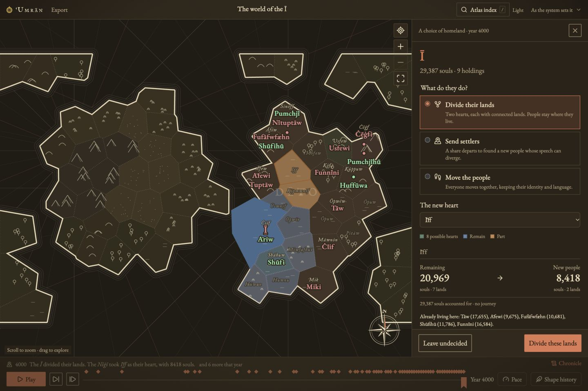

**Two tellings, one year** lays alternate histories side by side. Return to
a past year and choose **Continue in another telling** to run from there,
keeping the first future. Their charts pan and zoom together; follow a
shared people to compare its holdings, population, language family and words.
**What changed in speech** shows sound laws found only in one telling,
changed specimen words, loans by donor, and the languages descended in each.
Each link opens the right account, and either telling can be continued from
the year in view. Returning before an action only moves your reading:
the first new choice starts another telling.

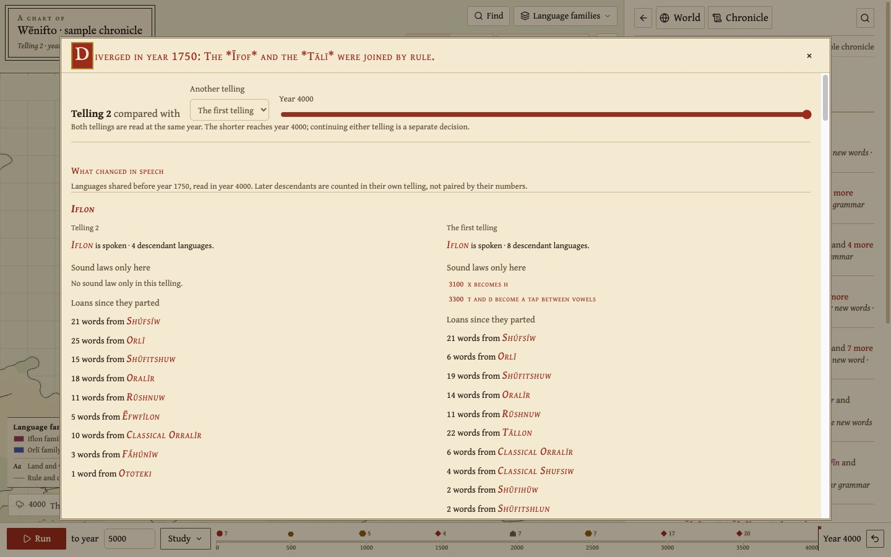

The **atlas index** finds peoples, languages, lands, states, faiths, and crafts
by name, older name, or meaning. Accents are optional when searching. Open it
with Find on the chart, or press `/` or `⌘/Ctrl K`.

The **chronicle** can be searched, read from either end, and filtered to the
journeys of peoples, the fortunes of states, faiths, language, or livelihood.
Sound changes can follow one language and its ancestors. Names in the
entries link to their cards. **Follow their fortunes** takes a people through
its turning points, with the chart and words at each moment, then returns to
the reading you left. Dictionaries also keep their search and selected word
when returning from a word's history.
On a phone, the [map fills the screen](docs/images/phone-sheet.jpg) and the card
rises over it as a sheet: a peek, half the screen, or the whole page. The
engine runs on its own thread, so the chart and Stop stay responsive while
the years pass.

The **chart** shows rivers in the ink of the coast, bending through the
lands they cross. Failed flows fade to a dashed line. Lakes are sea-filled
insets on the chart and globe; their extent is not modelled. Lettering grows
as you zoom: broad names give way to peoples, then local land, river, and
lake names. Choose the author's names or one people's viewpoint explicitly.
Place cards keep names across languages, shore lands, and outlets.
**Weather** colours lands by their zone's departure from usual conditions.
Climate annals lead to the zone's card and history. A kilometre scale
follows the zoom.

Sheets settle onto the desk and lift away without delaying the next click.
Only one is open at a time: closing a dialog returns to the folio and reading
it temporarily covered. Keyboard links focus the next card's heading; pointer
links leave focus alone. A single 25-year advance or intervention briefly
marks changed holdings and new state borders, while playback keeps the chart
quiet. The system's reduced-motion setting makes all these changes immediate.

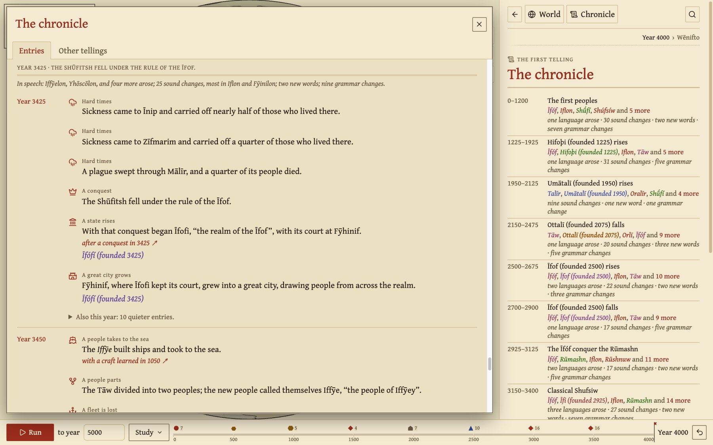

The **book** is its own screen, with a contents rail and a bookmark that
keeps your place. Read the lands, peoples, languages, and chronicle in chapter
order; long ledgers stay folded until wanted. **Take it elsewhere** makes an
edition with every chapter opened: print just the book, save a self-contained
web page with its fonts, chart, and chapter links, or take the complete text
as Markdown, with every word's evidence opened too if asked. A save file
keeps the world, its tellings, and the author's notes for further work.
**Words compared** takes any list of meanings and leaves as a CSV sheet with
each word's root numbered, and a language's names leave the same way.

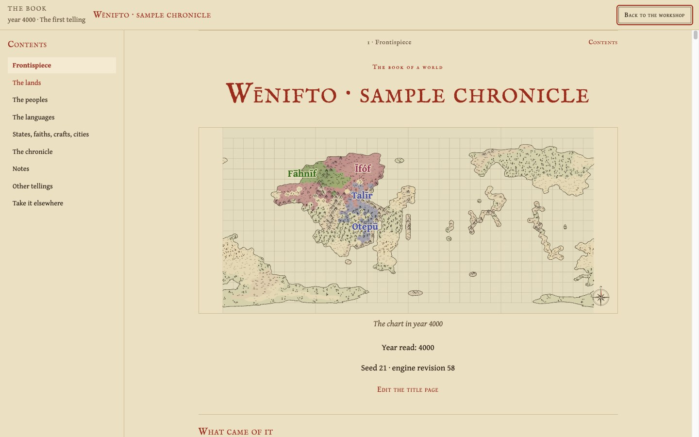

The **philologist's desk** begins blind. Align words from two languages,
choose meanings, and study recurring sound pairs without family names,
family colours, or descent. Keep a hypothesis in the margin, then **Reveal
the record** to read their common ancestry and the recorded roots beside
the method's evidence. The comparative method never reads that history.

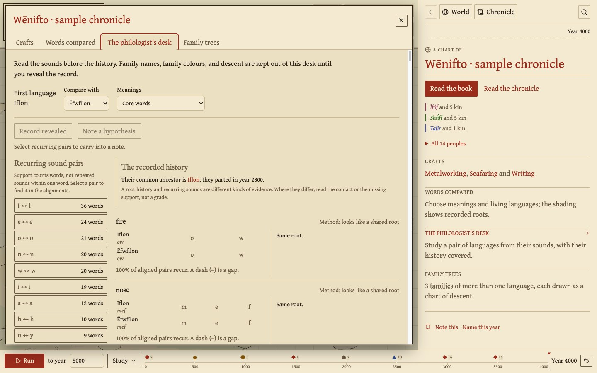

| | |
|---|---|
| 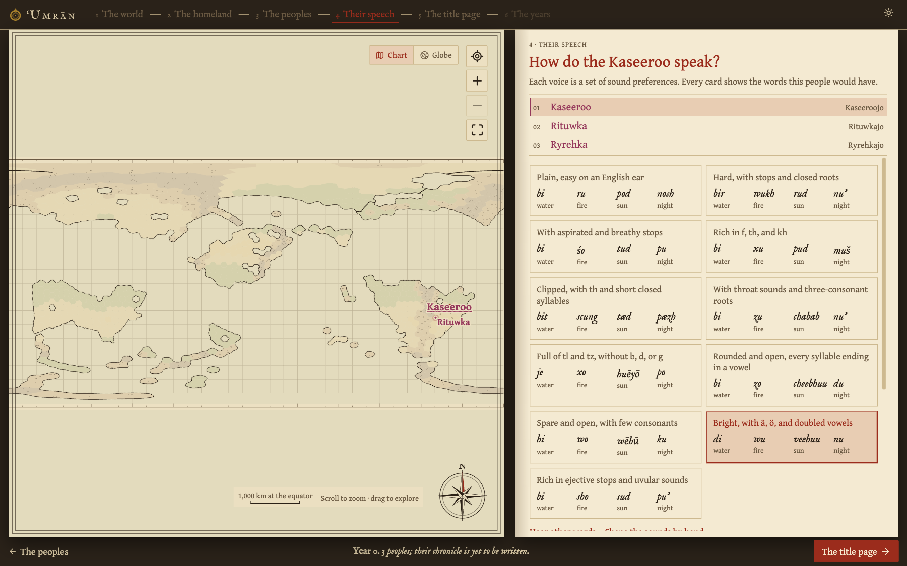 | 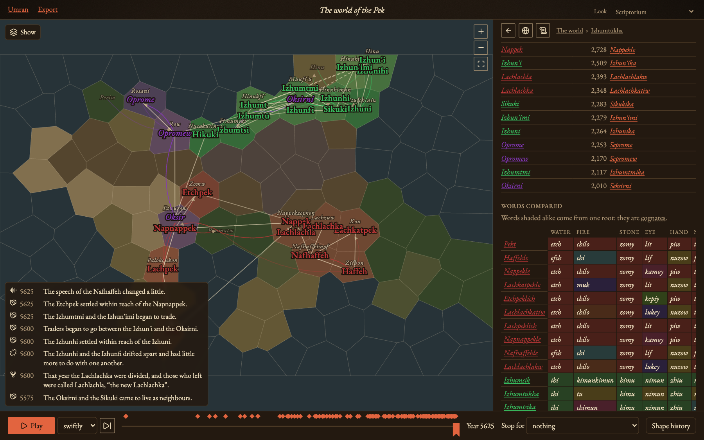 |
| **Founding a world.** Five steps over the chart. The coasts form from the engine's own plate-drift history; then a homeland; then one people, kin who parted with shared ancestral speech, or neighbours with languages of their own; then their speech, where every sound preset is a card of this people's own words and the author may give roots of their own; then the title page. Writing the chronicle runs the years at once. | **Words compared.** Basic words across the living languages, shaded alike when they come from one root (cognates). |
| 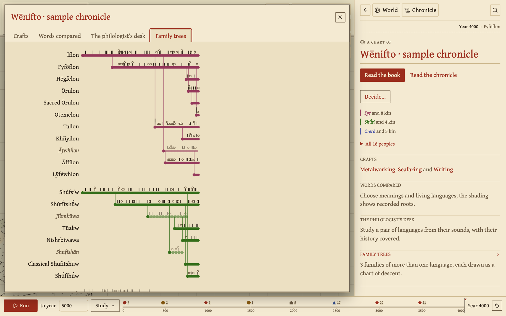 | 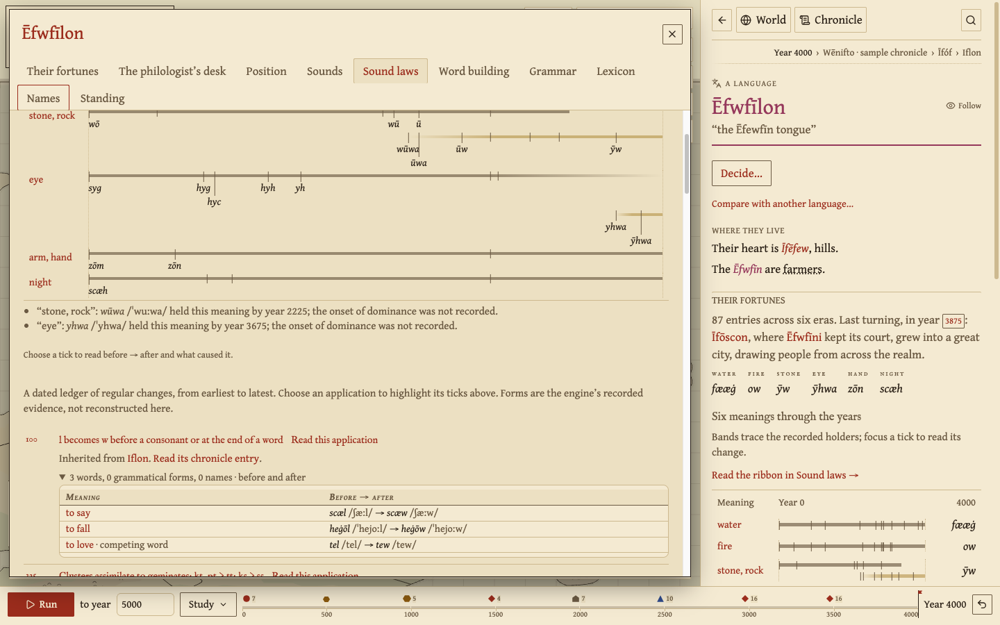 |
| **Family trees.** The world's languages branch as peoples part; ended languages and classical forms keep their places in the record. Each language also has a card for its sounds, grammar, and word-building patterns. | **A language's evidence.** Six meanings through the years trace the words that held them and their changing forms. The dated law ledger links each application to its recorded words, grammar, and names before and after, and to the chronicle entry behind it. |

## How it is built

- **A Rust engine** (`crates/umran-sim`) holds all the linguistics. It has
  no knowledge of the browser and is tested natively.
- **A WebAssembly facade** (`crates/umran-web`, via `wasm-bindgen`) keeps
  the history and serves the browser ready-to-show JSON views.
- **A React and TypeScript front end** (`web/`, built with Vite) only
  presents. It never makes or changes a word, and there is no backend.

A few decisions do most of the work:

- **Deterministic by construction.** Every random draw comes from its own
  ChaCha8 stream, keyed by what it is for. Adding a new process never
  shifts the draws of existing ones, and the same seed gives the same
  history natively and in WebAssembly.
- **History as a recipe.** A saved world is a seed plus the actions taken.
  Any past year is recovered by replaying, with cached checkpoints, so the
  timeline costs no extra storage and saves are tiny.
- **An honest comparative method.** The code that reconstructs which
  languages are related never reads the true family tree. It is only
  graded against it.
- **Grounded in data.** Sound frequencies come from
  [PHOIBLE](https://phoible.org/), the basic vocabulary is the
  Leipzig–Jakarta list, and borrowing is checked against the
  [World Loanword Database](https://wold.clld.org/). Statistical tests check
  behaviour in bands over many seeds rather than exact outputs.

[`docs/engine.md`](docs/engine.md) describes the model module by module,
and [`docs/history.md`](docs/history.md) covers replay, branching, and
saving. [`docs/book.md`](docs/book.md) describes the book, the four screens,
and the loop of founding, running, reading, and revising.

## Install and use offline

Umran is a progressive web app. After one online visit, the app and its
WebAssembly engine can reopen and run without a connection.

- **Chrome or Edge:** use the install icon in the address bar or the
  browser's install menu.
- **iPhone or iPad:** open it in Safari, then choose Share → Add to Home
  Screen.
- **Safari on Mac:** choose File → Add to Dock.

Worlds and unfinished founding drafts stay in local browser storage.
Resume a draft from the chart room; runs keep checkpoints of completed
years across reloads. If two tabs save the same world, both versions are
kept rather than one overwriting the other. Installing does not upload or
sync them. Some browsers keep an installed app's storage separate from its
browser tab, so export a save file and open it in the app if needed. Keep
exported backups; clearing site data can remove both worlds and offline files.

New editions offer "Save and reload" rather than interrupting playback.
Reloading first saves the latest generation; if saving fails, the update
waits so you can export the world. Other open windows wait for their own
reload.

## Run it locally

You need [rustup](https://rustup.rs/) (the Rust version is pinned in
`rust-toolchain.toml` and installs itself) and [Bun](https://bun.sh/).

```sh
bun install
bun run dev         # builds the WebAssembly and serves http://127.0.0.1:5173
bun run build       # a static site in dist/, all that deployment needs
cargo test --workspace
```

To check the PWA locally, run `bun run build` followed by `bun run preview`
and open `http://127.0.0.1:4173/`. Offline support is enabled only in
production builds; deployment requires HTTPS (localhost also works).
The manifest, icons, and service worker support subpaths such as `/umran/`.
Fonts fetched while the worker is active are cached too; fonts not yet
cached fall back to local serif faces when offline.

The engine also has command-line examples for studying one mechanism at a
time, such as how fast words wear down or how a family drifts apart. They
are listed in [`docs/engine.md`](docs/engine.md#studying-one-mechanism).

## Project layout

```
crates/umran-sim   the engine: world, map, sounds, words, names, history
crates/umran-web   the WebAssembly facade and its JSON views
web/src            the React workbench: chart room, founding, workshop, cards, the book
docs/              the engine model and the history format
brand/             the astrolabe mark; `bun run brand` redraws icons and logos
AGENTS.md          architecture notes and the rules every change keeps
```

## Status

Umran is a work in progress. The mechanisms not yet modelled are listed
at the end of
[`docs/engine.md`](docs/engine.md#not-yet-modelled).

## The name

*ʿUmrān* is Ibn Khaldun's word for settled social life, the subject of his
*Muqaddimah* (1377): how peoples come together, rise, meet, and rule one
another. Umran is a small, playful attempt at the same subject, told
through the words people speak.

The mark is an astrolabe, the brass instrument of his world. Its plates
were engraved one for each clime, the latitude bands Ibn Khaldun used to
divide the inhabited quarter of the earth, *al-rubʿ al-maʿmūr*.

## License

[MIT](LICENSE)
