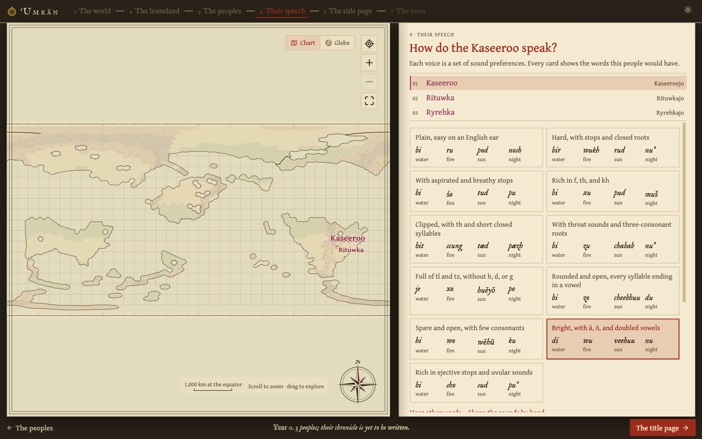
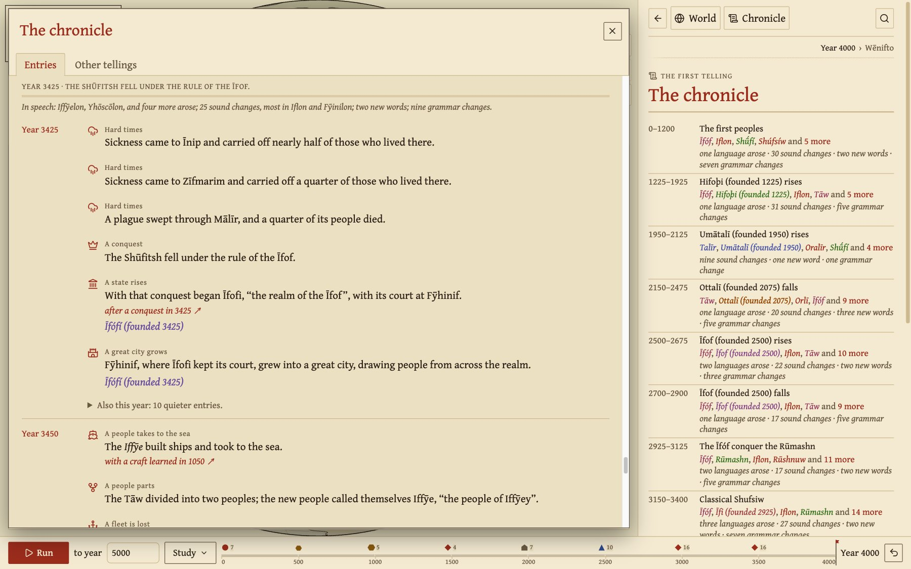
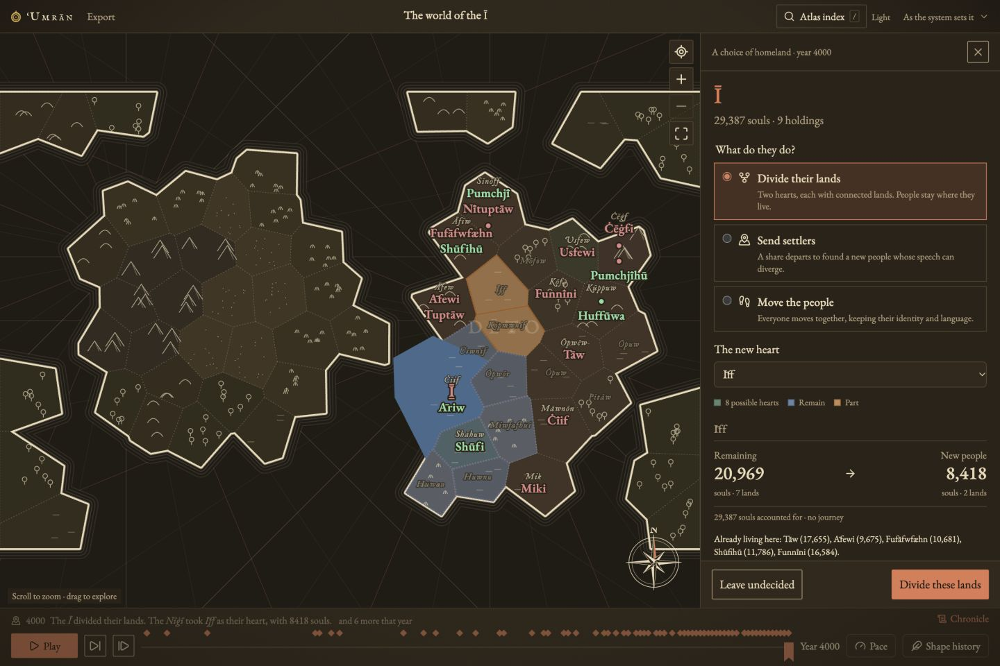
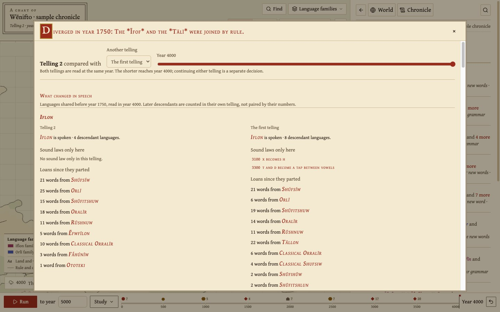
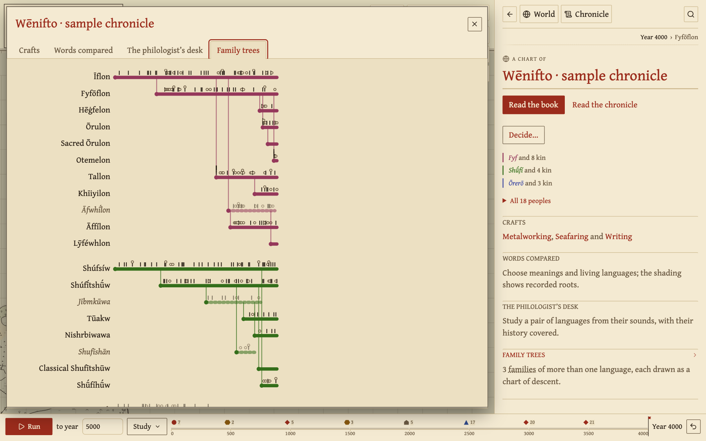
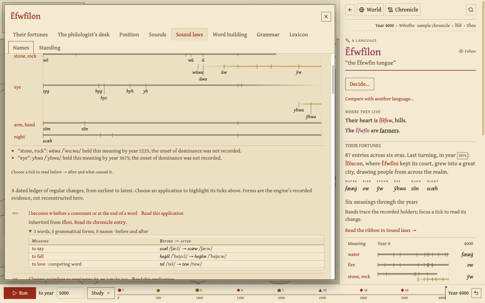
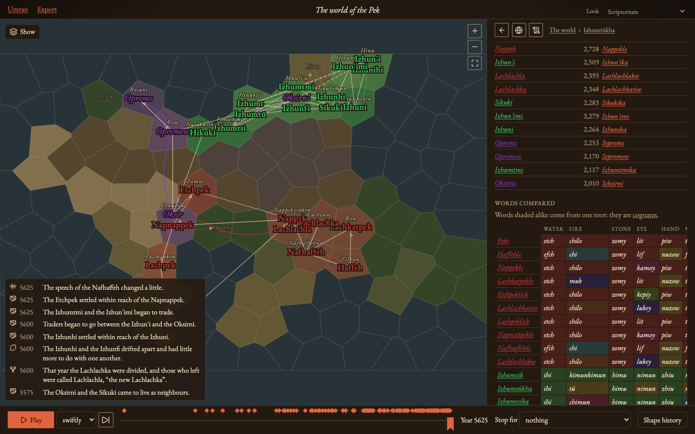
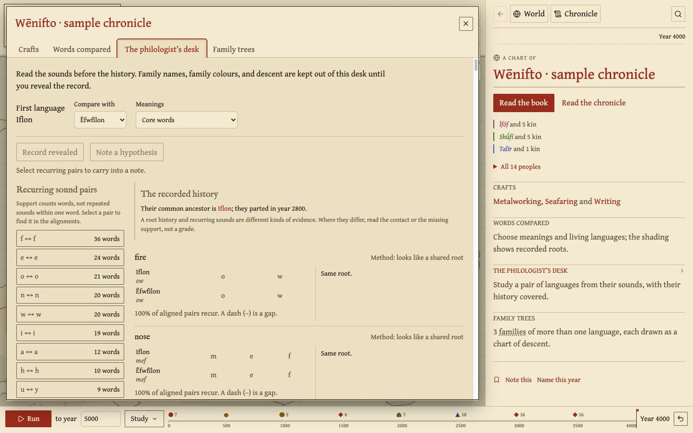

# Workbench guide

Umran writes the book of a world: its peoples, their fortunes, and the
languages that grew out of both. Found the world, run its years, read what
came of it, and decide where its history should turn. Each decision in the
past opens another telling of the same world.

[Open Umran](https://solforged.github.io/umran/) or return to the
[README](../README.md) for local setup.

## Found a world

The first visit opens the chart room. Choose **Found a new world** to work
through five steps over the chart:

1. Watch the coasts form from the engine's plate-drift history.
2. Choose a homeland.
3. Begin with one people, kin who parted with shared ancestral speech,
   or neighbours with languages of their own.
4. Shape their speech. Every sound preset previews this people's words.
   You can also supply roots of your own.
5. Finish the title page and choose the year to write through.

**Write the chronicle** runs the years to that date. An unfinished founding
can be resumed from the chart room. To explore without founding, choose
**Read a chronicle already written** to open a sample four thousand years
along. Later visits resume the world left open.

## What happens in a world

Time passes in 25-year generations. The peoples' fortunes and languages
change together.

- **Sound change.** Each generation a language may take up a sound law,
  such as "s becomes z between vowels". Laws apply to every word at once,
  as real sound changes do, and the odds favour changes the speakers'
  sound preferences like. Each language puts its stress somewhere, on the
  first syllable or the next to last, and stress shapes what follows:
  unstressed vowels weaken and drop, as Latin *calidus* became Italian
  *caldo*, and clusters become long consonants, as *factum* became *fatto*.
  Lost consonants can leave lexical tone. Spelling marks its six pitches
  on the vowel (á à ǎ â ả ạ), including in names and exports; IPA keeps
  Chao tone letters (˥ ˩ and contours).
- **Waves.** A sound change can spread to neighbouring languages, mostly
  between close relatives. The lines where a change stopped (isoglosses)
  cut across the family tree, as dialect maps of real languages do.
- **Words compete.** Every meaning has one or more words competing for
  use. New words arise, old ones are renewed when they wear too short or
  sound like another word, and losers fall out of use.
- **Grammar.** Founding sets word order, object marking, and possessor
  placement. Daughters inherit the sketch, and sound change can wear the
  object's mark away, leaving word order to say who did what.
- **Borrowing.** Peoples in contact trade words, mostly from the more
  prestigious side. How readily a meaning is borrowed comes from that
  meaning alone, so patterns by field have to emerge on their own.
- **Peoples on a map.** Peoples forage, herd, or farm, and grow toward
  what their lands feed them. Farmers fill the plains and spread into
  land beside them; a people grown too large or too far-flung splits
  along its lands. Peoples migrate, cross the sea, meet as neighbours,
  trade, conquer one another, and learn new ways of life from each other.
  Famine, plague, and drought strike. Small peoples die out or are
  absorbed by larger kin.
- **States and standard languages.** Peoples conquer one another, or a
  large farming people under pressure organizes itself, and a state
  arises with a capital city its tribute feeds. In time its court's
  speech becomes a standard: it changes slowly, pulls its kindred
  dialects toward it, and draws subjects of other families to shift to
  it. Some standards keep foreign words out. When the state falls, its
  dialects drift apart again, as Latin did into the Romance languages.
- **Great cities.** A capital draws people from across its realm. When
  several languages share its streets long enough, its townsfolk come to
  speak a koiné of their own, levelled toward what most of them share, as
  Hellenistic Greek was. Cities pass sound changes to one another before
  the countryside between them.
- **Classical languages.** A written standard is in time fixed as it
  stood, by grammarians or by its state's fall, and people go on writing
  it while their speech moves on, as Latin was written over Romance
  Europe. It lends learned words to its daughters until they are written
  in their own right, by a new state or a translated scripture.
- **Crafts, faiths, and writing.** Metalworking, riding, seafaring, and
  writing begin where they can and pass from people to people. Each
  brings words a language lacked: borrowed from the teachers, stretched
  from old words ("write" from "scratch"), or built. A teacher may found a
  faith whose frozen speech becomes a sacred language, lending learned
  words long after and turning converts' old gods into demons. Writing
  fixes spelling while speech moves on, as English *knight* shows.
- **Schisms and pilgrims.** A faith spread too far, claimed by a realm of
  its own, or kept in a sacred speech its followers no longer understand
  may break into branches. Pilgrims travel to its holy places and carry
  words home, and a holy land held by others draws the faithful to war.
- **Temper.** Each people leans somewhere between warlike and peaceable,
  insular and welcoming, worldly and devout, egalitarian and
  hierarchical, rooted and restless, landbound and seagoing. Its temper
  comes from its land and way of life, passes to its daughters, drifts
  toward its neighbours', and turns with what befalls it: subjects who
  throw off their rulers grow warlike, long comfort softens. Temper
  shapes how readily a people fights, trades, borrows, converts, founds
  a state, wanders, and puts to sea.
- **Personal names.** Each language names its people its own way, from
  words its way of life and temper favour: herders for horses and
  cattle, farmers for grain, warlike peoples for spears. Kings and
  prophets carry such names.
- **Language shift.** A people can give up its language for a more
  prestigious one, keeping its own accent and some old words.
- **Names are words.** Peoples, languages, and lands are named from the
  speakers' own vocabulary ("the people of the river"), and their names
  go through the same sound changes as everything else.

Umran is a work in progress. The [engine model](engine.md) describes these
mechanisms in detail, with calibration results and a list of
[what is not yet modelled](engine.md#not-yet-modelled).

## Read the chart

In the workshop, the chart fills the window and opens on its peoples'
lands. The cartouche in its top-left corner names the world, its telling,
and the year. It opens the world's menu: other tellings, notes, the book,
day or lamplight, and the way back to the chart room. Find and the map's
layers sit top-right. A legend explains the ink. The chronicle's latest
line appears over the map's foot, above the time bar and timeline.

The world is spherical. Choose **Globe** beside the map's navigation
controls to turn the same world through its poles, then return to the
chart for close reading. Both views share lands, rivers, journeys, cards,
and founding placement. The engine measures spherical areas and
great-circle distances independently of the drawing. The default world
has 2,562 regions and a radius of 1,600 km; the vast world is Earth-sized.

New worlds use `continental-v6`, a short history of plate drift. One
supercontinent rifts into plates that move apart, collide, and pass over
hotspots. That history leaves coasts, mountain ranges, island arcs, inland
seas, and lakes, so the continents differ in size and shape. Land covers
about 30% of the sphere. Older worlds keep the geography they were drawn
with. The globe turns at frame rate on every world size.

Hover or focus a land, river, lake, city, or marker to read its gazetteer:
what its holders call it, what other languages call it, pronunciations,
meanings, and a few facts. Click to keep the place open, then follow
**Open** to its card.

Rivers bend through the lands they cross. Failed flows fade to a dashed
line. Lakes are sea-filled insets on the chart and globe; their extent is
not modelled. Lettering grows as you zoom: broad names give way to peoples,
then local land, river, and lake names. Choose the author's names or one
people's viewpoint. Place cards keep names across languages, shore lands,
and outlets. **Weather** colours lands by their zone's departure from usual
conditions. Climate annals lead to the zone's card and history. A kilometre
scale follows the zoom.

Find searches peoples, languages, lands, states, faiths, and crafts by name,
older name, or meaning. Accents are optional. Open it from the chart or
press `/` or `⌘/Ctrl K`.

On a phone, the [map fills the screen](images/phone-sheet.jpg) and the card
rises over it as a sheet: a peek, half the screen, or the whole page. The
engine runs on its own thread, so the chart and Stop stay responsive while
the years pass.

Only one dialog is open at a time. Closing it restores the card and reading
it covered. Keyboard links focus the next card's heading; pointer links
leave focus alone. A single 25-year advance or decision briefly marks
changed holdings and new state borders, while playback keeps the chart
quiet. The system's reduced-motion setting makes these changes immediate.

## Read the chronicle

The chronicle reads in eras, from the beginning. Headline entries appear
at full weight, with a line on what happened to speech in each era. The
year's quieter bookkeeping folds into one line. The chronicle's card is a
table of contents. A people's or a language's fortunes read in the same eras.

Where the engine recorded why something happened, the chronicle says so:
"after hard times", "as the city grew". Each phrase links to the entry
that caused it.

Search the chronicle, read from either end, or filter to the journeys of
peoples, states, faiths, language, or livelihood. Sound changes can follow
one language and its ancestors. Names in entries link to their cards.
**Follow their fortunes** takes a people through its turning points, with
the chart and words at each moment, then returns to the reading you left.
Dictionaries also keep their search and selected word when returning from
a word's history.

## Make decisions

**A choice of homeland** opens beside the chart from a people's card.
Divide its territory around a new heart, send a chosen share of settlers,
or move everyone together. The engine previews connected holdings,
residents, travel routes, crowding, and any capital lost. Applying the
choice opens its recorded account. **Return before this choice** lets you
try another way. The first telling is kept even when both decisions
happened in the same year.

A language's **Decide…** menu and the frontispiece offer three ways to
shape its speech:

- **A sound change** previews every catalog law against the language's
  words and names, or takes a law written in notation (`h > ∅ / V _ V`,
  `stress > penult`). Each rule is read back in plain words. Every changed
  word, grammatical form, and name is shown before applying it.
- **A word of your own** gives a language a form for any meaning, in the
  catalog's sounds. Sound change wears it like any other word.
- **A meaning of your own** adds a concept the catalog lacks, with its
  kind, field, borrowability, and the meaning it derives from. Every living
  language finds a word for it in the years that follow, and a founding
  can name such meanings in its roots.

## Compare tellings

You can stop at any year, return to the past, and try something different.
Every telling keeps its name and future, ready to read or continue again.

Choose **Continue in another telling** from a past year to run from there
while keeping the first future. Compare two tellings at the same year.
Their charts pan and zoom together; follow a shared people to compare its
holdings, population, language family, and words.

**What changed in speech** shows sound laws found only in one telling,
changed specimen words, loans by donor, and the languages descended in
each. Each link opens the right telling. Either can be continued from the
year in view. Returning before an action only moves your reading: the
first new choice starts another telling.

## Study languages

Each language has sections for sounds, grammar, word building, names,
and a phrasebook of fixed phrases rendered by its current grammar.
Family trees include living, ended, and classical languages. Each branch
carries its sound laws as ticks, with a ring where a change came in a wave
from another language. Ticks before a parting are shared by every
daughter, and a tick opens the change.

A language's sounds are charted by place and manner. A sound is darker
the more words say it, and marked where it was gained or lost since the
language arose. The lexicon opens with the vocabulary by field, every
word tinted by its origin.

Six meanings trace their words through the years above the dated sound-law
ledger. Each application links to its recorded words, grammatical forms,
and names before and after, and to the chronicle entry behind it.

**Words compared** takes any list of meanings. Words from the same root
(cognates) share shading. Languages no longer spoken can join the list,
with their words as they last stood.

The **philologist's desk** begins blind. Align words from two languages,
choose meanings, and study recurring sound pairs without family names,
family colours, or descent. Keep a hypothesis in the margin, then
**Reveal the record** to read their common ancestry and recorded roots
beside the method's evidence. The comparative method never reads that
record.

## Take the data out

Under the section it comes from, a link downloads that section as a file
for other tools. The engine writes each file from the year being read.

| File | Found under | What it holds |
| --- | --- | --- |
| Lexicon, CSV | A language's lexicon | One row per current word: meaning, spelling, speech, IPA, noun class, field, origin, source, the year it entered, and whether it is the main word or a competing one. The `id` column names the meaning and is the same in every language. |
| Names, CSV | A language's names | Given names, peoples, lands, rivers, lakes, cities, states, and faiths, with what each meant. |
| Sound laws, text | A language's sound laws | Every law in order, with its year and how it arrived. Each is in the notation the law form reads, so it can be pasted there and given to another language. |
| Sound laws, JSON | A language's sound laws | The same ledger with every word, grammatical form, and name before and after each law. |
| Phrasebook, text | A language's phrasebook | Interlinear text, the layout linguists give examples in: each phrase, its sounds, and a gloss set under every word, then a translation. |
| Words compared, CSV | The world's card | One row per meaning, with each language's word, its sounds, its root number, and its origin. Words with the same root number are cognates. The last column gives each root its first form. |
| Family tree, Newick | A language's position, and the world's family trees | Each family as a tree for tree-drawing and phylogenetics programs, with branch lengths in years. Every language is a tip that ends when it fell silent, or in the year being read. |

A CSV file opens with a byte-order mark, so that a spreadsheet program
reads its IPA correctly.

## Read and export the book

Open the book from the workshop's cartouche. Its contents rail and bookmark
keep your place. Read the lands, peoples, languages, and chronicle in
chapter order. Long ledgers stay folded until wanted.

**Take it elsewhere** makes an edition with every chapter opened: print
just the book, save a self-contained web page with its fonts, chart, and
chapter links, or take the complete text as Markdown. Choose whether to
include every word's evidence. A save file keeps the world, all its
tellings, and the author's notes for further work. A frozen world is that
save file with the world written out beside it as data: every people,
language, word, name, and chronicle entry as it stands in the year the
book reads. It opens like any save.

## Offline use and saving

Umran is a progressive web app. After one online visit, the app and its
WebAssembly engine can reopen and run without a connection.

- **Chrome or Edge:** use the install icon in the address bar or the
  browser's install menu.
- **iPhone or iPad:** open it in Safari, then choose Share → Add to Home
  Screen.
- **Safari on Mac:** choose File → Add to Dock.

Worlds and unfinished founding drafts stay in local browser storage.
Resume a draft from the chart room. Runs keep checkpoints of completed
years across reloads. If two tabs save the same world, both versions are
kept rather than one overwriting the other. Installing does not upload or
sync them. Some browsers keep an installed app's storage separate from its
browser tab, so export a save file and open it in the app if needed. Keep
exported backups. Clearing site data can remove both worlds and offline
files. A browser may also clear a site's data when the device runs short
of space. Umran asks it not to once a world is saved, and the foot of the
chart room says whether it agreed.

New editions offer **Save and reload** rather than interrupting playback.
Reloading first saves the latest generation; if saving fails, the update
waits so you can export the world. Other open windows wait for their own
reload.

The engine changes between editions, and a newer one can tell the same
world differently. Umran keeps a record of each world as the engine last
read it. When a world was saved by another engine revision, the warning
says what the new one reads differently: the year the chronicles part
ways, which peoples and languages have other names, and how many names
and words differ, with examples under *What differs*. It also says when
nothing differs. Umran keeps that save as it stood. Download it, or the
world as it read then, from the warning or from **Take it elsewhere** in
the book. The frontispiece records the
revision the world was first written under. A newer engine replays a
frozen world's recipe like any other, but the record in the file stays as
it was written. Freeze a world whose names you mean to keep.

Worlds saved before engine revision 33 keep their original data and open
recovery. Their old flat-map land IDs cannot be replayed on the new sphere.
Spherical saves retain their recorded geography when opened, exported, or
branched. A new terrain generator does not redraw an existing world. See
[history and saving](history.md) for replay and save-format details.
